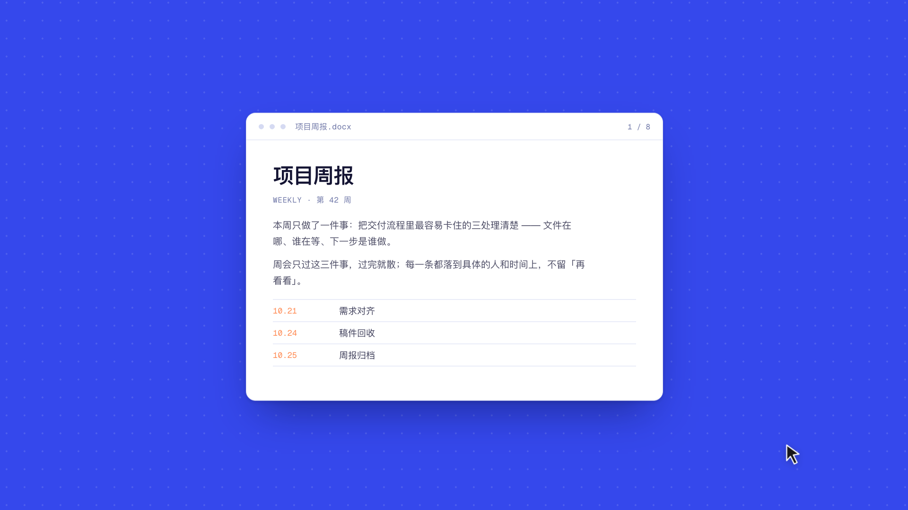

# dsh-macos-quicklook

给 DSH 的交付卡片加一个「鼠标停上去按空格，弹 macOS 原生 Quick Look」的入口。

## 演示片

22 秒，纯代码渲染（每帧由 HTML 截图生成，不是录屏）。

▶ **[下载或播放 `dsh-macos-quicklook-22s.mp4`（4 MB）](https://github.com/Naitang1207/dsh-macos-quicklook/releases/download/v0.1.0/dsh-macos-quicklook-22s.mp4)**，也可以从仓库里取：[`promo/dsh-macos-quicklook-22s.mp4`](promo/dsh-macos-quicklook-22s.mp4)



## 为什么需要它

DSH 右侧栏自带的文件预览只有 pdfjs + shiki（PDF 和代码高亮），没有 docx / xlsx / pptx 的渲染器，
Office 文件在 DSH 里根本看不了。这个插件不自己解析文件，而是直接叫系统面板
`QLPreviewPanel` —— 就是 Finder 里按空格用的那一套，所以能预览的范围等于 macOS 支持的范围：
docx、xlsx、pptx、pages/numbers/keynote、pdf、图片、音视频、markdown、纯文本、代码。

## 用法

**鼠标停在交付卡片上，按空格。** 整张卡片都是热区，不用对准按钮。

卡片右上角「打开 / 在访达中显示」旁边多一个空格键图标（扁矩形描边，不是 `␣` 字符——U+2423 在很多 UI 字体里会渲染成接近正方形、看着像复选框），鼠标进入卡片时会亮起来提示此处可按空格；
点它效果相同，给不用键盘的时候。

| 操作 | 效果 |
| --- | --- |
| 空格（鼠标在卡片上） | 弹出预览；开着同一个文件时再按一次收起 |
| 鼠标停到另一张卡片按空格 | 直接换成那个文件，不重播进场动画 |
| Esc | 收起（只在鼠标停在卡片上时由插件处理，且不阻断 DSH 自己的 Esc） |

面板就是系统 Quick Look 面板本身，所以面板内的交互跟 Finder 里按空格是同一套实现，
不是我们另画的。

鼠标不在卡片上时，空格还是普通空格（对话输入、页面滚动都不受影响）；焦点在输入框里时插件不拦空格。

鼠标在卡片上停稳 **0.5 秒**，键盘焦点会自动落到那张卡片上（窗口本身不在前台时会先把它激活），
所以从别的应用切回来时不用先点一下页面。这个时长可调，见下面的「设置」。

## 设置

插件在 DSH 的 **设置 → 常规** 里注册了一行「快速预览」（位置在「链接打开方式」下面、
「输入框回车」上面），三项都即时生效、不用重载插件：

| 设置 | 默认 | 说明 |
| --- | --- | --- |
| 悬停接管焦点 | 500 ms | 鼠标在卡片上停多久把键盘焦点移过去；`0` 表示立即，上限 3000 |
| 关闭后聚焦输入框 | 开 | 预览关掉后把光标送回聊天输入框 |
| 双击卡片直接预览 | 关 | 打开后双击整张卡片即可预览，不必按空格 |

值存在 `~/.dsh/quicklook.json`，读写走 `GET/POST /api/quicklook.settings`。没有用 cordis 的
`Config`，是因为那种配置写在 `cordis.patch.yml` 里、改完必须重载插件才生效，调一个数值要等重载。

这一行是插件自绘的：宿主对 `settings.general.item` 不传任何 props、也不投影 label
（文档原话「copy, current value, and the write path are all yours」），标题、当前值和写回都在
`client.js` 的 `QuickLookSettings` 里。

## 面板行为

大部分由系统决定，这也是改用官方面板的原因：

- **打开是从卡片位置放大**：面板通过 `previewPanel(_:sourceFrameOnScreenFor:)` 拿到卡片的屏幕矩形，
  缩放动画（zoom effect）由系统自己做 —— 不是我们算贝塞尔曲线。实测系统在为一次打开动画会回调这个
  方法约 10 次。
- **位置和尺寸也由系统定**：1728×1117 的屏上实测为 `816×849` 居中，比自绘时贴窗口右侧更接近
  Finder 的观感，也不用再自己维护一套比例常量。
- **收起是 0.1s 快速淡出**，实测约 50ms 内面板就不可见。

  > 这里有个**做不到的事**：系统自己触发的关闭（点面板外面、Esc）会把面板缩回卡片位置，而我们
  > 主动 `orderOut` 只能原地淡出。截图差分的质心可以量出来——系统关闭质心贴卡片 (111,159 vs 卡片
  > 91,116)，主动关闭停在屏幕中心 (211,150)。`resignKey()`、激活别的 app 让 helper 失活、合成
  > Esc 键事件、`panel.animator().setFrame(卡片矩形)` 全试过，都不走 zoom back，面板 frame 也不受
  > 我们控制。这是 `QLPreviewPanel` 公开 API 的边界，所以选了「短淡出」这个观感最接近的替代。
- **第一次打开快**：面板首次 `makeKeyAndOrderFront` 要 ~72ms（建窗口 + 唤醒 quicklookd）。
  helper 启动 0.6s 后会在屏幕外真显示一次再收起，把首次降到 ~22ms，同文件再开约 5ms。
- **换文件不播动画**：同一面板 `reloadData` 换内容，位置不动（按你的要求「干脆不做动画」）。
- **收起后焦点自动回 DSH**：面板需要 key window（否则收不到 Esc 和触控板手势），所以打开期间
  helper 会短暂成为前台；关闭后用它记住的原前台应用 `activate()` 把焦点还回去——等价于在 Dock
  上点一下 DSH，零轮询零开销。如果「关闭后聚焦输入框」开着，光标会进一步落到聊天输入框上
  （取页面里 `getBoundingClientRect().bottom` 最大的那个可编辑元素，不依赖宿主的 class 名）。

## 实现

一个 bundle 两个半边 + 一个常驻 helper：

| 部分 | 文件 | 作用 |
| --- | --- | --- |
| 浏览器 | `client.js` | 往 `deliverables.file.actions` 槽挂空格键图标按钮（13×6 扁矩形 + 描边，随主题色）；document 层用 `data-presented-file` 找鼠标所在卡片；捕获阶段拦空格（Esc 只在卡片上时处理）；POST 到 `api/quicklook.preview` |
| Host | `index.js` | 把授权坐标还原成绝对路径，把命令写进常驻 helper 的 stdin；helper 由 `ctx.effect` 管生命周期 |
| helper | `helper/main.swift` | 官方 `QLPreviewPanel` + `PreviewController`（`NSApplicationDelegate`、`QLPreviewPanelDataSource`、`QLPreviewPanelDelegate`）；透明 1×1 宿主窗口只 `orderFrontRegardless()` 用来让 app 可被激活 |

开关状态只由 helper 判定：浏览器半不缓存「面板开着吗」，只发 `action: 'toggle'`。
原因是用户按 Esc 关闭时面板是系统关的、页面收不到事件，前端缓存必然过期，过期就会发出无效的
hide，表现为「按了没反应、得按两下」。

helper 的关键设置（都是踩过坑才有的）：

```swift
panel.hidesOnDeactivate = false      // NSPanel 默认 true；后台进程不 active 会"显示但看不见"
panel.level = .floating
panel.collectionBehavior = [.canJoinAllSpaces, .fullScreenAuxiliary]
host.orderFrontRegardless()          // 宿主窗口不能 makeKey，会把 key 从面板抢走导致面板自关
panel.makeKeyAndOrderFront(nil)      // key 必须留在面板上
```

## 坐标 → 路径

走 DSH 自己的授权校验，不另开捷径：

1. `sessionQuery.readEvent({ sessionId, seq, before: 0, after: 0 })` 读回该 seq 的 `deliverables/presented` 事件
2. `data.files[index]` 过 `isPresentedFile` 校验（`path` 非空字符串、`description` 可选字符串）
3. `workspaceFiles.stat({ sessionId, workspaceRoot: session.cwd ?? sandboxPolicy.workspaceRoot }, file.path)` 得到 `absolutePath`

路由挂在 `connection.fetch` 上（`POST /api/quicklook.preview`），自带 Host/Origin 与登录 token
的信任栅栏，浏览器之外的调用会被 401 拦掉。未知 `action` 返回 400，helper 不可用返回 503，
请求被取消返回 499。

## 文件结构

```
package.json           bundle 声明（dsh.bundle.patch / dsh.client.inject）
cordis.patch.yml       插入 id=quicklook 的 loader 条目
index.js               Host 半
client.js              浏览器半
helper/main.swift      面板源码（QLPreviewPanel）
helper/qlhelper        编译好的二进制（随包发布）
locale/{zh,en}.json    插件名与描述
icon.svg               64×64 图标
```

运行时还会在 `~/.dsh/quicklook.json` 写设置（不在这个包目录里，删掉即恢复默认）。

## 编译与热重载

改了 `helper/main.swift` 要重新编译，再让 Host 起新进程：

```bash
cd <这个仓库>/helper && swiftc -O main.swift -o qlhelper
```

```bash
# 热重载（改代码用这个，不用退出 DSH）
plugin_manager set_plugin target=include:quicklook enabled=false
plugin_manager set_plugin target=include:quicklook enabled=true
```

`set_plugin` 的 target 必须是 `include:<patchId>` 这种精确 entryId，传包名会报 unknown-plugin。

## 安装 / 卸载

```bash
dsh plugin install link:<这个仓库的绝对路径>   # 或 plugin_manager install_bundle target=link:<目录>
dsh plugin remove @naitang1207/dsh-macos-quicklook
```

## 调试

两份日志，权限 0600：

- `~/.dsh/logs/quicklook-host.log` —— 每次请求的 body、返回 status、耗时
- `~/.dsh/logs/quicklook-helper.log` —— 每次 show/swap/hide 的 `visible / key / appActive / hostVisible / hostKey`，以及 1.2s 后的最终状态、`sourceFrame` 与 `cardRect` 的矩形

排查「没反应」时先看 host 日志有没有收到请求：只有一条说明卡在前端，两条且第一条没弹出说明
卡在 helper。手动跑 helper 调试时记得先把插件 disable，否则两个进程会抢同一个系统面板互相关闭。

## 已知限制

- **主动关闭做不到缩回卡片**（见上，`QLPreviewPanel` API 边界）。
- **多屏坐标没支持**：`screenRect` 的翻转基准固定取主屏 `frame.maxY`，DSH 窗口在副屏上时
  zoom 起点会错位。要支持得按窗口矩形与各屏求相交面积选屏。
- **悬停抢焦点有副作用**：如果你正在别的应用里打字、鼠标恰好停在交付卡片上超过设定时长，
  焦点会被抢过来。觉得太主动就把「悬停接管焦点」的毫秒数调大（比如 2000）。
- **失败时界面没有反馈**：只剩 `console.warn` 与日志。宿主没有公开的 toast/通知 service 契约，
  不想为此去依赖别的插件内部结构。
- **文本类没有分流到 DSH 右侧栏**：.md / 代码原本可以走侧栏高亮，那需要调侧栏内部视图接口，
  没有公开契约，所以统一走原生预览。

## 走过的弯路（别重复走）

- `qlmanage -p`：只会开一个固定尺寸、无动画、抢焦点的独立窗口，位置尺寸都不受控。
- 自绘 `NSPanel` + `QLPreviewView`：动画 / 键盘 / 手势 / 缩放全要自己复刻，返工四轮仍不达标
  （回弹、不丝滑、触控板手势收不到）。`QLPreviewView` 只是可嵌入视图，不带动画与手势。
- 读官方头文件 `$(xcrun --sdk macosx --show-sdk-path)/System/Library/Frameworks/QuickLookUI.framework/Headers/QLPreviewPanel.h`
  才发现 `QLPreviewPanel` 本来就提供 zoom effect 和键盘处理——做 macOS 原生 API 先读 SDK 头文件。
